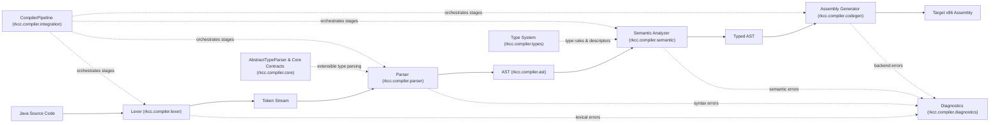

# Compiler Architecture — RKCC JavaCompiler

> **Status Notice (Milestone 02):** This document defines the architectural blueprint, package boundaries, stage contracts, and proposed Java interfaces for `JavaCompiler`. **No compiler stages, `AbstractTypeParser.java`, concrete AST nodes, type implementations, semantic analyzer, or assembly generator are implemented yet.** Refer to [PROGRESS.md](PROGRESS.md) for verified implementation status.

## 1. Overall Compiler Architecture

`JavaCompiler` follows a classic, cleanly decoupled multi-stage compiler pipeline designed for independent team development and incremental Java language expansion:

- **Front-End (`lexer`, `parser`, `ast`, `core`):** Converts Java source code into a token stream and constructs a structured, source-span-annotated Abstract Syntax Tree (AST) with extensible type-parser delegation.
- **Middle-End (`types`, `semantic`):** Resolves symbols and scopes, validates semantic rules, attaches resolved type descriptors, and emits a validated Typed AST.
- **Back-End (`codegen`):** Lowers the validated Typed AST into target x86 assembly without re-parsing source text or performing type inference.
- **Cross-Cutting (`diagnostics`, `integration`):** Provides uniform error/warning reporting across all stages and orchestrates the end-to-end compilation pipeline.

### Key Architectural Principles

1. **Contract-First Modularity:** Every stage communicates strictly through immutable or well-bounded contracts (tokens, AST nodes, type descriptors, diagnostics, assembly artifacts).
2. **Separation of Concerns:** Each stage performs one responsibility. Lexical scanning never builds AST nodes; parsing never runs semantic type checking; semantic analysis never emits x86 instructions; codegen never touches raw tokens.
3. **Fail-Safe Diagnostics:** Every stage reports structured diagnostics with `SourceSpan` metadata to a shared `DiagnosticReporter` rather than throwing unstructured `RuntimeException`s for user-code errors.
4. **Type Extensibility:** Type parsing (`AbstractTypeParser`) and type representation (`TypeDescriptor`) are designed to accommodate the full Java type family over time while keeping Milestone 03+ focused on the agreed integral-language subset.

---

## 2. Package Structure

```text
src/main/java/rkcc/compiler/
├── core/          # Shared stage contracts, AbstractTypeParser contract, type-parser registry
├── lexer/         # Lexical scanner, token model, token stream implementation
├── parser/        # Grammar parser coordinating token streams and type parsers
├── ast/           # AST node contracts, visitor/traversal interfaces, concrete AST nodes
├── semantic/      # Symbol tables, scopes, semantic validation, Typed AST output
├── types/         # TypeDescriptor contracts, TypeKind, primitive & reference type models
├── codegen/       # Target x86 assembly emitter and register/stack lowering
├── integration/   # CompilerPipeline orchestrator and CLI/API entry points
└── diagnostics/   # Diagnostic severity, Diagnostic record/class, SourceSpan, DiagnosticReporter
```

Each package currently contains `package-info.java` establishing module ownership and boundaries without premature placeholder implementation classes.

---

## 3. Compiler Pipeline Diagram



---

## 4. Stage-by-Stage Specification

### Stage 1: Java Source Code → Lexer → Token Stream
- **Owner:** Krishna (`rkcc.compiler.lexer`)
- **Responsibility:** Scan raw Java source characters into meaningful lexical tokens (keywords, identifiers, literals, operators, punctuation), strip whitespace/comments, track line/column positions, and provide lookahead-capable access via `TokenStream`.
- **Expected Input:** `SourceUnit` / character stream (`String` content + source name/path).
- **Expected Output:** `TokenStream` (ordered sequence of `Token` instances terminated by an `EOF` token).
- **Dependencies:** `rkcc.compiler.diagnostics` (for reporting invalid characters, unterminated literals/comments).
- **Error-Handling Expectations:** Report lexical errors (`DiagnosticSeverity.ERROR`) with exact `SourceSpan`, recover to the next valid character/token boundary when possible, and continue scanning so multiple lexical errors can be surfaced in one pass.

### Stage 2: Token Stream → Parser → AST
- **Owner:** Jatin (`rkcc.compiler.parser`, `rkcc.compiler.ast`) — delegating extensible type declarations/literals/expressions to `AbstractTypeParser` handlers in `rkcc.compiler.core`.
- **Responsibility:** Validate syntactic grammar rules against the `TokenStream`, coordinate registered `AbstractTypeParser` handlers for type-specific constructs, and construct an untyped syntactic AST (`CompilationUnit` / `AstNode` hierarchy).
- **Expected Input:** `TokenStream` (plus registered `AbstractTypeParser` handlers where applicable).
- **Expected Output:** `CompilationUnit` (root `AstNode` representing parsed declarations, statements, and expressions with `SourceSpan` metadata).
- **Dependencies:** `rkcc.compiler.lexer` (read-only token/stream contracts), `rkcc.compiler.core`, `rkcc.compiler.ast`, `rkcc.compiler.diagnostics`.
- **Error-Handling Expectations:** Report syntax errors (`Unexpected token`, `Missing semicolon`, etc.) via `DiagnosticReporter` with expected vs. actual token details and source spans; synchronize at statement/block boundaries (`;`, `}`) to avoid cascading failures.

### Stage 3: AST → Semantic Analyzer → Typed AST
- **Owner:** Janesh (`rkcc.compiler.semantic`, `rkcc.compiler.types`)
- **Responsibility:** Build and traverse lexical/block scopes, populate symbol tables, verify variable declaration-before-use and uniqueness rules, evaluate type compatibility/promotion rules via `rkcc.compiler.types`, and annotate or transform the AST into a validated `TypedCompilationUnit` / `TypedAstNode` representation.
- **Expected Input:** Unvalidated `CompilationUnit` (`AstNode` tree).
- **Expected Output:** `TypedCompilationUnit` (validated AST where every expression, declaration, and symbol carries a resolved `TypeDescriptor` and symbol binding).
- **Dependencies:** `rkcc.compiler.ast`, `rkcc.compiler.types`, `rkcc.compiler.core`, `rkcc.compiler.diagnostics`.
- **Error-Handling Expectations:** Report semantic errors (undeclared identifier, duplicate declaration, type mismatch, invalid operand types, narrowing assignment error) via `DiagnosticReporter`; halt before code generation if any `ERROR`-severity diagnostic exists.

### Stage 4: Typed AST → Assembly Generator → Target Assembly
- **Owner:** Riya (`rkcc.compiler.codegen`)
- **Responsibility:** Translate validated `TypedCompilationUnit` nodes into target x86 assembly instructions, managing stack frame layout, register allocation/temporaries, expression lowering, and control-flow labels.
- **Expected Input:** Validated `TypedCompilationUnit` (guaranteed free of prior-stage errors).
- **Expected Output:** `AssemblyOutput` (generated assembly text, target metadata, and optional diagnostics).
- **Dependencies:** `rkcc.compiler.semantic` (Typed AST contract), `rkcc.compiler.types` (`TypeDescriptor` sizes/signedness), `rkcc.compiler.core`, `rkcc.compiler.diagnostics`.
- **Error-Handling Expectations:** Should never encounter syntax or type errors if prior stages succeeded; if an unsupported construct or target limit is reached, emit a clear `CODEGEN`-phase diagnostic via `DiagnosticReporter` instead of silently emitting invalid assembly.

### Cross-Cutting Modules
- **Diagnostics (`rkcc.compiler.diagnostics`, Owner: Krishna):** Shared `Diagnostic`, `DiagnosticSeverity`, `DiagnosticPhase`, `SourceSpan`, and `DiagnosticReporter` contracts consumed by every stage.
- **Pipeline Integration (`rkcc.compiler.integration`, Owner: Krishna):** `CompilerPipeline` wires stages in sequence, stops code generation if earlier stages produced errors, and returns a unified `CompilationResult` containing assembly output (if successful) and all collected diagnostics.

---

## 5. Proposed Shared Interface Signatures

> **Note:** These signatures are **architectural design proposals** documented in Markdown for Milestone 02. They are not yet compiled `.java` files so that no unresolved dependencies or premature concrete classes are introduced before Milestone 03.

### Diagnostics (`rkcc.compiler.diagnostics`)

```java
public record SourceSpan(String sourceName, int startLine, int startColumn, int endLine, int endColumn) {}

public enum DiagnosticSeverity { ERROR, WARNING, INFO }

public enum DiagnosticPhase { LEXER, PARSER, SEMANTIC, CODEGEN, PIPELINE }

public record Diagnostic(
        DiagnosticPhase phase,
        DiagnosticSeverity severity,
        String code,
        String message,
        SourceSpan span) {}

public interface DiagnosticReporter {
    void report(Diagnostic diagnostic);
    boolean hasErrors();
    java.util.List<Diagnostic> getDiagnostics();
}
```

### Token & Lexer Contracts (`rkcc.compiler.lexer`)

```java
public interface Token {
    String kind();      // Or enum TokenType defined in lexer contract
    String lexeme();
    SourceSpan span();
}

public interface TokenStream {
    Token peek();
    Token peek(int lookahead);
    Token advance();
    boolean isAtEnd();
    boolean match(String expectedKind);
}

public interface Lexer {
    TokenStream tokenize(String sourceName, String sourceCode, DiagnosticReporter diagnostics);
}
```

### Type System Contracts (`rkcc.compiler.types`)

```java
public enum TypeCategory {
    INTEGRAL, FLOATING_POINT, BOOLEAN, CHAR, STRING, ARRAY, REFERENCE, VOID, UNKNOWN
}

public interface TypeDescriptor {
    String name();
    TypeCategory category();
    int byteSize();
    boolean isSigned();
    boolean isAssignableTo(TypeDescriptor target);
}
```

### AST & Parser Contracts (`rkcc.compiler.ast`, `rkcc.compiler.parser`)

```java
public interface AstNode {
    SourceSpan span();
    <R> R accept(AstVisitor<R> visitor);
}

public interface AstVisitor<R> {
    // Visitor dispatch methods defined alongside concrete AST node hierarchy in Milestone 04+
}

public interface Parser {
    AstNode parse(TokenStream tokens, DiagnosticReporter diagnostics);
}
```

### Semantic & Typed AST Contracts (`rkcc.compiler.semantic`)

```java
public interface TypedAstNode {
    AstNode sourceNode();
    TypeDescriptor resolvedType();
    SourceSpan span();
}

public interface SemanticAnalyzer {
    TypedAstNode analyze(AstNode astRoot, DiagnosticReporter diagnostics);
}
```

### Code Generation & Pipeline Contracts (`rkcc.compiler.codegen`, `rkcc.compiler.integration`)

```java
public record AssemblyArtifact(String targetName, String assemblyText) {}

public interface CodeGenerator {
    AssemblyArtifact generate(TypedAstNode typedRoot, DiagnosticReporter diagnostics);
}

public record CompilationResult(
        boolean success,
        AssemblyArtifact assembly,
        java.util.List<Diagnostic> diagnostics) {}

public interface CompilerPipeline {
    CompilationResult compile(String sourceName, String sourceCode);
}
```

---

## 6. `AbstractTypeParser.java` Contract Design

> **Restriction Check:** `AbstractTypeParser.java` is **not** implemented in Milestone 02. Below is its complete architectural design for implementation in Milestone 03.

### Design Purpose

`AbstractTypeParser` (planned for `rkcc.compiler.core`) provides a uniform extension point for recognizing and parsing type-specific Java constructs (such as type declarations, typed literals, and type-specific expressions/initializers) without coupling the main `Parser` to every future Java data type.

### Proposed Contract Structure

```java
public abstract class AbstractTypeParser {

    /**
     * Identifies the canonical Java type handled by this parser extension
     * (e.g., "int", "long", "boolean", "String", etc.).
     */
    public abstract TypeDescriptor getSupportedType();

    /**
     * Fast lookahead check indicating whether the current position in the
     * TokenStream can be parsed by this handler (e.g., type keyword or typed literal).
     */
    public abstract boolean supports(TokenStream tokens);

    /**
     * Parses a type declaration or typed literal/expression fragment from the
     * token stream into a structured AST representation, reporting any syntax
     * errors via the provided DiagnosticReporter.
     */
    public abstract AstNode parseTypeConstruct(TokenStream tokens, DiagnosticReporter diagnostics);

    /**
     * Optional hook returning semantic constraints or type metadata hints associated
     * with the parsed AST construct, consumed by SemanticAnalyzer without duplicating
     * symbol-table or type-checking logic inside the parser.
     */
    public TypeDescriptor resolveDeclaredTypeHint() {
        return getSupportedType();
    }
}
```

### How `AbstractTypeParser` Enforces Separation of Concerns

1. **Extensible Type Handlers:** The main `Parser` holds an ordered registry of `AbstractTypeParser` instances (`TypeParserRegistry` in `core`). Adding a new type (e.g., `double` or `String`) only requires registering a new subclass rather than rewriting core parser branches.
2. **No Parser Duplication:** `Parser` owns overall compilation-unit grammar, operator precedence, control-flow structure, and error synchronization; `AbstractTypeParser` subclasses focus strictly on type-specific syntax recognition and AST node construction.
3. **Clean Semantic Integration:** `AbstractTypeParser` exposes `TypeDescriptor` metadata (`getSupportedType()` / `resolveDeclaredTypeHint()`), allowing `SemanticAnalyzer` to validate declarations, promotions, and symbol scopes cleanly without putting symbol tables inside `AbstractTypeParser`.
4. **Backend Support Without Codegen Coupling:** `AbstractTypeParser` **never** emits x86 assembly or knows about registers/NASM. Instead, the `TypeDescriptor` carried into the `TypedAstNode` gives `CodeGenerator` everything it needs (size, signedness, category) to emit target instructions.

---

## 7. Java Type Extensibility Roadmap

The architecture (`TypeDescriptor`, `TypeCategory`, `AbstractTypeParser`) is explicitly designed to support future expansion across all standard Java types:

| Type Group | Planned Types | Initial Milestone Focus | Current Status |
| --- | --- | --- | --- |
| **Integral Primitives** | `byte`, `short`, `int`, `long` | **Agreed initial subset** (integer subset first) | **Not yet implemented** |
| **Other Primitives** | `char`, `float`, `double`, `boolean` | Post-initial milestones | **Not yet implemented** |
| **Standard Library / Composite** | `String`, Arrays (`T[]`) | Post-primitive milestones | **Not yet implemented** |
| **Object-Oriented** | Reference types (classes/objects) | Long-term milestones | **Not yet implemented** |

> **Important:** None of these data types are implemented in Milestone 02. Only the architectural boundaries and extensibility hooks have been designed.

---

## 8. Module Dependencies

Allowed compile-time dependency direction (strictly acyclic):

```text
diagnostics      -> (no internal compiler dependencies)
types            -> diagnostics
core             -> diagnostics, types
lexer            -> diagnostics, core
ast              -> diagnostics, types, core
parser           -> diagnostics, core, lexer (contracts), ast
semantic         -> diagnostics, core, ast, types
codegen          -> diagnostics, core, types, semantic (Typed AST contracts)
integration      -> all module contracts (orchestration layer)
```

Rules enforced by this graph:
- `diagnostics` sits at the bottom and has zero dependencies on any compiler stage.
- `codegen` depends on `semantic` (Typed AST) and `types`, never on `lexer` or `parser`.
- `parser` depends on `lexer` token/stream contracts and `ast`, never on `semantic` or `codegen`.

---

## 9. Design Decisions & Initial Supported Language Scope

### Recorded Design Decisions
1. **Java 17 Baseline:** Leverage Java 17 features (`record`, `sealed` interfaces where appropriate, `switch` expressions) while maintaining clean compatibility with Maven `--release 17`.
2. **Immutable Data Contracts:** `Token`, `SourceSpan`, `Diagnostic`, and `AssemblyArtifact` are designed as immutable value types for thread safety and predictable testing.
3. **Diagnostic-First Error Handling:** Prefer structured `DiagnosticReporter` entries over throwing exceptions for user source errors so multiple diagnostics can be collected per compilation run.
4. **Proposed Backend Target:** **Linux x86-64 using NASM syntax** is adopted as the *proposed* assembly backend target for architectural planning. This is **not yet a confirmed supervisor requirement** and remains subject to sign-off before Milestone 06 (`codegen`) implementation begins.

### Initial Supported Language Scope (Planned for Upcoming Milestones)
The initial implementation will focus strictly on the **agreed integral-language subset** (exact grammar scope to be finalized before Milestone 04):
- Integer declarations, integer literals, basic arithmetic/assignment expressions, and minimal program/entry wrapper sufficient to compile, type-check, and emit verifiable assembly.
- Complex OOP features (inheritance, generics, lambdas, exceptions, standard library APIs) are explicitly out of scope for initial milestones.
