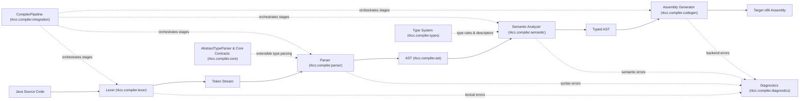

# Compiler Architecture — RKCC JavaCompiler

> **Status Notice (Milestone 09A):** Shared compiler foundation contracts (`SourceLocation`, `Diagnostic*`, `TokenType`, `Token`, `TokenStream`, `ListTokenStream`, `Lexer`, `TypeCategory`, `TypeDescriptor`, `AstNode`, `AssemblyGenerationContext`, `AssemblyBackend`, `AbstractTypeParser`, `TypeRegistry`) are finalized and verified across 62 unit and foundation integration tests. **Production Parser, concrete AST nodes, Semantic Analyzer, production Type handlers (`byte`..`boolean`, `String`, arrays, reference types), Assembly Generator, CompilerPipeline, and CLI remain pending for Milestone 09B+.** Refer to [PROGRESS.md](PROGRESS.md) for the readiness checklist.

## 1. Overall Compiler Architecture

`JavaCompiler` follows a classic, cleanly decoupled multi-stage compiler pipeline designed for independent team development and incremental Java language expansion:

- **Front-End (`lexer`, `parser`, `ast`, `core`):** Converts Java source code into a token stream and constructs a structured, source-span-annotated Abstract Syntax Tree (AST) with extensible type-parser delegation.
- **Middle-End (`types`, `semantic`):** Resolves symbols and scopes, validates semantic rules, attaches resolved type descriptors, and emits a validated Typed AST.
- **Back-End (`codegen`):** Lowers the validated Typed AST into target x86 assembly without re-parsing source text or performing type inference.
- **Cross-Cutting (`diagnostics`, `integration`):** Provides uniform error/warning reporting across all stages and orchestrates the end-to-end compilation pipeline.

### Key Architectural Principles

1. **Contract-First Modularity:** Every stage communicates strictly through immutable or well-bounded contracts (tokens, AST nodes, type descriptors, diagnostics, assembly artifacts).
2. **Separation of Concerns:** Each stage performs one responsibility. Lexical scanning never builds AST nodes; parsing never runs semantic type checking; semantic analysis never emits x86 instructions; codegen never touches raw tokens.
3. **Fail-Safe Diagnostics:** Every stage reports structured diagnostics with `SourceSpan` metadata to a shared `DiagnosticReporter` rather than throwing unstructured `RuntimeException`s for user-code errors.
4. **Type Extensibility:** Type parsing (`AbstractTypeParser`) and type representation (`TypeDescriptor`) are designed to accommodate the full Java type family over time while keeping Milestone 03+ focused on the agreed integral-language subset.

---

## 2. Package Structure

```text
src/main/java/rkcc/compiler/
├── core/          # Shared stage contracts, AbstractTypeParser contract, type-parser registry
├── lexer/         # Lexical scanner, token model, token stream implementation
├── parser/        # Grammar parser coordinating token streams and type parsers
├── ast/           # AST node contracts, visitor/traversal interfaces, concrete AST nodes
├── semantic/      # Symbol tables, scopes, semantic validation, Typed AST output
├── types/         # TypeDescriptor contracts, TypeKind, primitive & reference type models
├── codegen/       # Target x86 assembly emitter and register/stack lowering
├── integration/   # CompilerPipeline orchestrator and CLI/API entry points
└── diagnostics/   # Diagnostic severity, Diagnostic record/class, SourceSpan, DiagnosticReporter
```

Each package currently contains `package-info.java` establishing module ownership and boundaries without premature placeholder implementation classes.

---

## 3. Compiler Pipeline Diagram



---

## 4. Stage-by-Stage Specification

### Stage 1: Java Source Code → Lexer → Token Stream
- **Owner:** Krishna (`rkcc.compiler.lexer`)
- **Responsibility:** Scan raw Java source characters into meaningful lexical tokens (keywords, identifiers, literals, operators, punctuation), strip whitespace/comments, track line/column positions, and provide lookahead-capable access via `TokenStream`.
- **Expected Input:** `SourceUnit` / character stream (`String` content + source name/path).
- **Expected Output:** `TokenStream` (ordered sequence of `Token` instances terminated by an `EOF` token).
- **Dependencies:** `rkcc.compiler.diagnostics` (for reporting invalid characters, unterminated literals/comments).
- **Error-Handling Expectations:** Report lexical errors (`DiagnosticSeverity.ERROR`) with exact `SourceSpan`, recover to the next valid character/token boundary when possible, and continue scanning so multiple lexical errors can be surfaced in one pass.

### Stage 2: Token Stream → Parser → AST
- **Owner:** Jatin (`rkcc.compiler.parser`, `rkcc.compiler.ast`) — delegating extensible type declarations/literals/expressions to `AbstractTypeParser` handlers in `rkcc.compiler.core`.
- **Responsibility:** Validate syntactic grammar rules against the `TokenStream`, coordinate registered `AbstractTypeParser` handlers for type-specific constructs, and construct an untyped syntactic AST (`CompilationUnit` / `AstNode` hierarchy).
- **Expected Input:** `TokenStream` (plus registered `AbstractTypeParser` handlers where applicable).
- **Expected Output:** `CompilationUnit` (root `AstNode` representing parsed declarations, statements, and expressions with `SourceSpan` metadata).
- **Dependencies:** `rkcc.compiler.lexer` (read-only token/stream contracts), `rkcc.compiler.core`, `rkcc.compiler.ast`, `rkcc.compiler.diagnostics`.
- **Error-Handling Expectations:** Report syntax errors (`Unexpected token`, `Missing semicolon`, etc.) via `DiagnosticReporter` with expected vs. actual token details and source spans; synchronize at statement/block boundaries (`;`, `}`) to avoid cascading failures.

### Stage 3: AST → Semantic Analyzer → Typed AST
- **Owner:** Janesh (`rkcc.compiler.semantic`, `rkcc.compiler.types`)
- **Responsibility:** Build and traverse lexical/block scopes, populate symbol tables, verify variable declaration-before-use and uniqueness rules, evaluate type compatibility/promotion rules via `rkcc.compiler.types`, and annotate or transform the AST into a validated `TypedCompilationUnit` / `TypedAstNode` representation.
- **Expected Input:** Unvalidated `CompilationUnit` (`AstNode` tree).
- **Expected Output:** `TypedCompilationUnit` (validated AST where every expression, declaration, and symbol carries a resolved `TypeDescriptor` and symbol binding).
- **Dependencies:** `rkcc.compiler.ast`, `rkcc.compiler.types`, `rkcc.compiler.core`, `rkcc.compiler.diagnostics`.
- **Error-Handling Expectations:** Report semantic errors (undeclared identifier, duplicate declaration, type mismatch, invalid operand types, narrowing assignment error) via `DiagnosticReporter`; halt before code generation if any `ERROR`-severity diagnostic exists.

### Stage 4: Typed AST → Assembly Generator → Target Assembly
- **Owner:** Riya (`rkcc.compiler.codegen`)
- **Responsibility:** Translate validated `TypedCompilationUnit` nodes into target x86 assembly instructions, managing stack frame layout, register allocation/temporaries, expression lowering, and control-flow labels.
- **Expected Input:** Validated `TypedCompilationUnit` (guaranteed free of prior-stage errors).
- **Expected Output:** `AssemblyOutput` (generated assembly text, target metadata, and optional diagnostics).
- **Dependencies:** `rkcc.compiler.semantic` (Typed AST contract), `rkcc.compiler.types` (`TypeDescriptor` sizes/signedness), `rkcc.compiler.core`, `rkcc.compiler.diagnostics`.
- **Error-Handling Expectations:** Should never encounter syntax or type errors if prior stages succeeded; if an unsupported construct or target limit is reached, emit a clear `CODEGEN`-phase diagnostic via `DiagnosticReporter` instead of silently emitting invalid assembly.

### Cross-Cutting Modules
- **Diagnostics (`rkcc.compiler.diagnostics`, Owner: Krishna):** Shared `Diagnostic`, `DiagnosticSeverity`, `DiagnosticPhase`, `SourceSpan`, and `DiagnosticReporter` contracts consumed by every stage.
- **Pipeline Integration (`rkcc.compiler.integration`, Owner: Krishna):** `CompilerPipeline` wires stages in sequence, stops code generation if earlier stages produced errors, and returns a unified `CompilationResult` containing assembly output (if successful) and all collected diagnostics.

---

## 5. Implemented Contracts & Provisional Future Signatures

> **Milestone 09A Update:** Finalized shared foundation contracts (`AstNode` now exposes `default Optional<SourceLocation> location()`, `AssemblyGenerationContext` validates non-null attribute keys/values, and all foundation integration workflows are verified). Provisional stage drivers (`Parser`, `TypedAstNode`, `SemanticAnalyzer`, `AssemblyArtifact`, `CodeGenerator`, `CompilationResult`, `CompilerPipeline`) remain design proposals awaiting Milestone 09B team alignment.

### Finalized Foundation Contracts (Milestones 03–09A)

- **`rkcc.compiler.core.TypeRegistry`**: Session-scoped registry mapping case-sensitive Java type names to `AbstractTypeParser<?>` instances (`register`, atomic multi-type registration, `resolve`, `resolveRequired`, `resolve(Token)`, `supports`, `unregister`, `getRegisteredTypes`, `getRegisteredParsers`, `size`, `isEmpty`).
- **`rkcc.compiler.core.AbstractTypeParser<T extends AstNode>`**: Extensible base class for type parsing and assembly delegation (`getTypeDescriptor()`, `getSupportedTypeName()`, `getSupportedTypeNames()`, `supports(...)`, `parse(TokenStream)`, `generateAssembly(...)`).
- **`rkcc.compiler.core.AssemblyBackend` & `AssemblyGenerationContext`**: Backend delegation SPI (`targetName()`, `emitAssembly(AstNode, TypeDescriptor, AssemblyGenerationContext)`).
- **`rkcc.compiler.ast.AstNode`**: Base AST contract declaring `nodeKind()`, `typeDescriptor()`, and `default Optional<SourceLocation> location()`.
- **`rkcc.compiler.types.TypeCategory` & `TypeDescriptor`**: Extensible Java type classification and metadata contract.
- **`rkcc.compiler.diagnostics.*`**: `SourceLocation`, `DiagnosticSeverity`, `CompilerPhase`, `DiagnosticCode`, `Diagnostic`, `DiagnosticCollector`, `DiagnosticFormatter`, `CompilerException`.
- **`rkcc.compiler.lexer.*`**: `TokenType`, `Token`, `TokenStream`, `ListTokenStream`, `UnexpectedTokenException`, `Lexer`, `LexicalException`.

### Provisional Future Contracts (Not Yet Implemented)

#### Diagnostics (`rkcc.compiler.diagnostics`)

```java
public record SourceSpan(String sourceName, int startLine, int startColumn, int endLine, int endColumn) {}

public enum DiagnosticSeverity { ERROR, WARNING, INFO }

public enum DiagnosticPhase { LEXER, PARSER, SEMANTIC, CODEGEN, PIPELINE }

public record Diagnostic(
        DiagnosticPhase phase,
        DiagnosticSeverity severity,
        String code,
        String message,
        SourceSpan span) {}

public interface DiagnosticReporter {
    void report(Diagnostic diagnostic);
    boolean hasErrors();
    java.util.List<Diagnostic> getDiagnostics();
}
```

#### Stage Driver Contracts (`lexer`, `parser`, `semantic`, `codegen`, `integration`)

```java
public interface Lexer {
    TokenStream tokenize(String sourceName, String sourceCode, DiagnosticReporter diagnostics);
}

public interface AstVisitor<R> {
    // Visitor dispatch methods defined alongside concrete AST node hierarchy
}

public interface Parser {
    AstNode parse(TokenStream tokens, DiagnosticReporter diagnostics);
}

public interface TypedAstNode {
    AstNode sourceNode();
    TypeDescriptor resolvedType();
    SourceSpan span();
}

public interface SemanticAnalyzer {
    TypedAstNode analyze(AstNode astRoot, DiagnosticReporter diagnostics);
}

public record AssemblyArtifact(String targetName, String assemblyText) {}

public interface CodeGenerator {
    AssemblyArtifact generate(TypedAstNode typedRoot, DiagnosticReporter diagnostics);
}

public record CompilationResult(
        boolean success,
        AssemblyArtifact assembly,
        java.util.List<Diagnostic> diagnostics) {}

public interface CompilerPipeline {
    CompilationResult compile(String sourceName, String sourceCode);
}
```

---

## 6. `AbstractTypeParser.java` Implementation

`AbstractTypeParser<T extends AstNode>` is implemented in `rkcc.compiler.core` as the common template-method base class for Java type parsing and backend assembly delegation.

### Architectural Correction from Milestone 02

Three deliberate corrections were made while turning the Milestone 02 sketch into compilable Milestone 03 code:
1. **Acyclic Backend Delegation (`AssemblyBackend` & `AssemblyGenerationContext` in `rkcc.compiler.core`):** Milestone 02 placed backend contracts only in `rkcc.compiler.codegen` while planning for `AbstractTypeParser` in `core` to support assembly delegation. Placing `AssemblyBackend` and `AssemblyGenerationContext` in `core` applies Dependency Inversion so `core` never depends on `codegen`, while `codegen` implements `AssemblyBackend`.
2. **Acyclic Token & AST Contracts:** `Token`, `TokenStream` (`lexer`), and `AstNode` (`ast`, depending only on `types`) have zero dependencies on `core`, allowing `AbstractTypeParser` in `core` to reference them cleanly.
3. **Validation Exceptions Before Full Diagnostics:** Because `DiagnosticReporter` is deferred to a later milestone, `AbstractTypeParser` enforces strict validation via `IllegalArgumentException`, `IllegalStateException`, and `UnsupportedOperationException` rather than inventing premature diagnostic stubs.

### Implemented Method Signatures

```java
public abstract class AbstractTypeParser<T extends AstNode> {

    protected AbstractTypeParser()
    protected AbstractTypeParser(AssemblyBackend assemblyBackend)

    public abstract TypeDescriptor getTypeDescriptor();
    protected abstract boolean supportsCurrentTokens(TokenStream tokens);
    protected abstract T parseTypeConstruct(TokenStream tokens);

    public final String getSupportedTypeName()
    public boolean supports(String typeName)
    public final boolean supports(TokenStream tokens)
    public final void requireSupportedType(String typeName)
    public final T parse(TokenStream tokens)

    public final Optional<AssemblyBackend> getAssemblyBackend()
    public final String generateAssembly(T node, AssemblyGenerationContext context)
    public final String generateAssembly(T node, AssemblyGenerationContext context, AssemblyBackend backend)

    protected String delegateAssemblyGeneration(
            T node, TypeDescriptor typeDescriptor, AssemblyGenerationContext context, AssemblyBackend backend)
    protected final TypeDescriptor validatedTypeDescriptor()
    public static String validateTypeName(String typeName)
}
```

### Example of Extending `AbstractTypeParser`

```java
public final class ExampleCustomTypeParser extends AbstractTypeParser<AstNode> {
    private final TypeDescriptor descriptor;

    public ExampleCustomTypeParser(TypeDescriptor descriptor, AssemblyBackend backend) {
        super(backend);
        this.descriptor = descriptor;
    }

    @Override
    public TypeDescriptor getTypeDescriptor() {
        return descriptor;
    }

    @Override
    protected boolean supportsCurrentTokens(TokenStream tokens) {
        return descriptor.typeName().equals(tokens.peek().lexeme());
    }

    @Override
    protected AstNode parseTypeConstruct(TokenStream tokens) {
        tokens.advance();
        // Construct and return concrete AstNode (implemented in Jatin's ast milestone)
        throw new UnsupportedOperationException("Concrete AST nodes belong to Milestone 04+");
    }
}
```

### How `AbstractTypeParser` Enforces Separation of Concerns

1. **Extensible Type Handlers:** New Java types can be plugged in via subclasses of `AbstractTypeParser<T>` without rewriting core `Parser` control flow.
2. **No Parser Duplication:** `Parser` owns compilation-unit grammar, operator precedence, and recovery; `AbstractTypeParser` focuses strictly on type-specific syntax recognition and validated AST construction.
3. **Backend Delegation Without Codegen Duplication:** `AbstractTypeParser` never emits x86 assembly directly; `generateAssembly(...)` validates the AST node, type metadata, and context, then delegates emission to `AssemblyBackend.emitAssembly(...)`.

---

## 7. Java Type Extensibility Roadmap

The architecture (`TypeDescriptor`, `TypeCategory`, `AbstractTypeParser`) is explicitly designed to support future expansion across all standard Java types:

| Type Group | Planned Types | Initial Milestone Focus | Current Status |
| --- | --- | --- | --- |
| **Integral Primitives** | `byte`, `short`, `int`, `long` | **Agreed initial subset** (integer subset first) | **Not yet implemented** |
| **Other Primitives** | `char`, `float`, `double`, `boolean` | Post-initial milestones | **Not yet implemented** |
| **Standard Library / Composite** | `String`, Arrays (`T[]`) | Post-primitive milestones | **Not yet implemented** |
| **Object-Oriented** | Reference types (classes/objects) | Long-term milestones | **Not yet implemented** |

> **Important:** None of these data types are implemented in Milestone 02. Only the architectural boundaries and extensibility hooks have been designed.

---

## 8. Module Dependencies

Allowed compile-time dependency direction (strictly acyclic):

```text
types            -> (no internal compiler dependencies)
diagnostics      -> (no internal compiler dependencies; owns SourceLocation)
lexer (contract) -> diagnostics (Token uses SourceLocation; TokenType, TokenStream)
ast (contract)   -> types, diagnostics (SourceLocation)
core             -> diagnostics, types, lexer (Token/TokenType/TokenStream), ast (AstNode)
parser           -> diagnostics, core, lexer, ast
semantic         -> diagnostics, core, ast, types
codegen          -> diagnostics, core (AssemblyBackend, AssemblyGenerationContext), types, ast, semantic
integration      -> all module contracts (orchestration layer)
```

Rules enforced by this graph:
- `types` and `diagnostics` (`SourceLocation`) have zero internal compiler dependencies.
- `lexer` token contracts (`TokenType`, `Token`, `TokenStream`) depend only on `diagnostics.SourceLocation`.
- `core` defines `AbstractTypeParser` and the `AssemblyBackend` SPI port, while `codegen` implements `AssemblyBackend` — keeping `core` and `codegen` completely acyclic.
- `codegen` depends on `semantic` / `ast` / `types` / `core`, never on `lexer` or `parser`.
- `parser` depends on `lexer` contracts, `core`, and `ast`, never on `semantic` or `codegen`.

---

## 9. Design Decisions & Initial Supported Language Scope

### Recorded Design Decisions
1. **Java 17 Baseline:** Leverage Java 17 features (`record`, `sealed` interfaces where appropriate, `switch` expressions) while maintaining clean compatibility with Maven `--release 17`.
2. **Immutable Data Contracts:** `Token`, `SourceSpan`, `Diagnostic`, and `AssemblyArtifact` are designed as immutable value types for thread safety and predictable testing.
3. **Diagnostic-First Error Handling:** Prefer structured `DiagnosticReporter` entries over throwing exceptions for user source errors so multiple diagnostics can be collected per compilation run.
4. **Proposed Backend Target:** **Linux x86-64 using NASM syntax** is adopted as the *proposed* assembly backend target for architectural planning. This is **not yet a confirmed supervisor requirement** and remains subject to sign-off before Milestone 06 (`codegen`) implementation begins.

### Initial Supported Language Scope (Planned for Upcoming Milestones)
The initial implementation will focus strictly on the **agreed integral-language subset** (exact grammar scope to be finalized before Milestone 04):
- Integer declarations, integer literals, basic arithmetic/assignment expressions, and minimal program/entry wrapper sufficient to compile, type-check, and emit verifiable assembly.
- Complex OOP features (inheritance, generics, lambdas, exceptions, standard library APIs) are explicitly out of scope for initial milestones.
